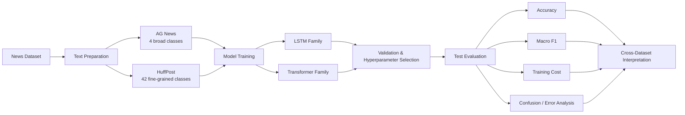
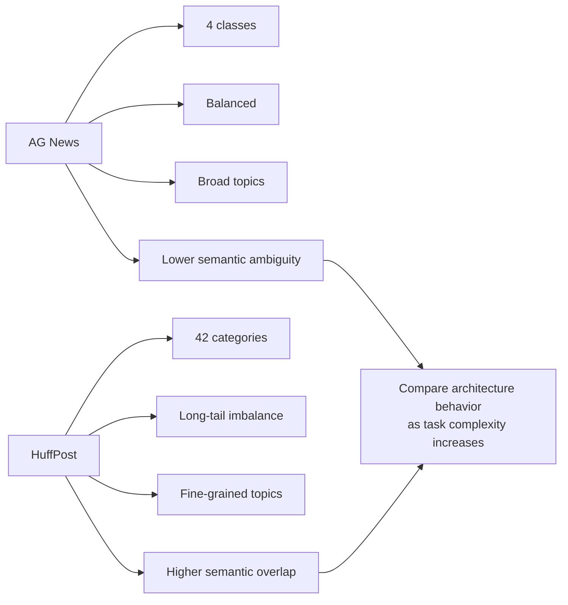
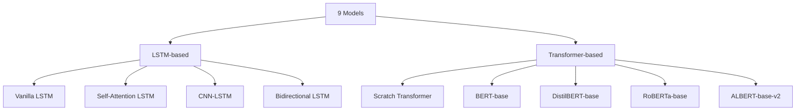
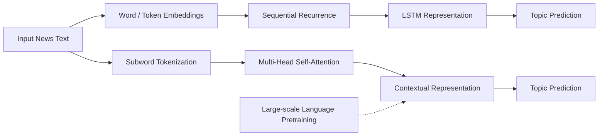
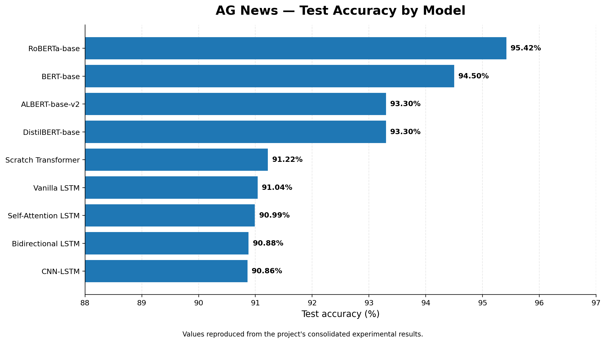
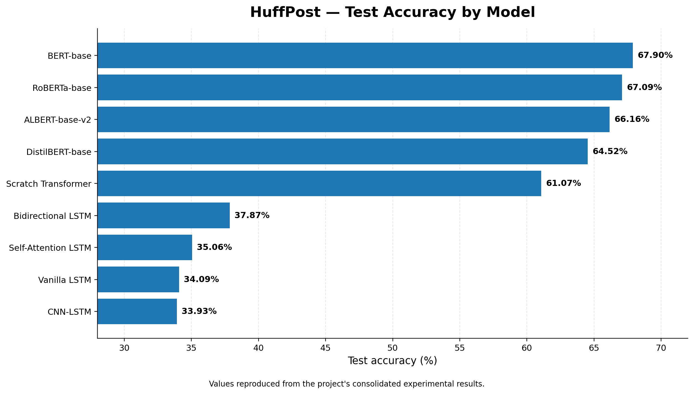
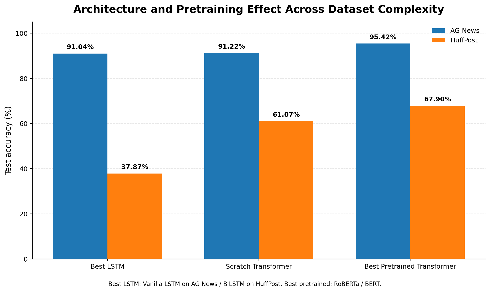
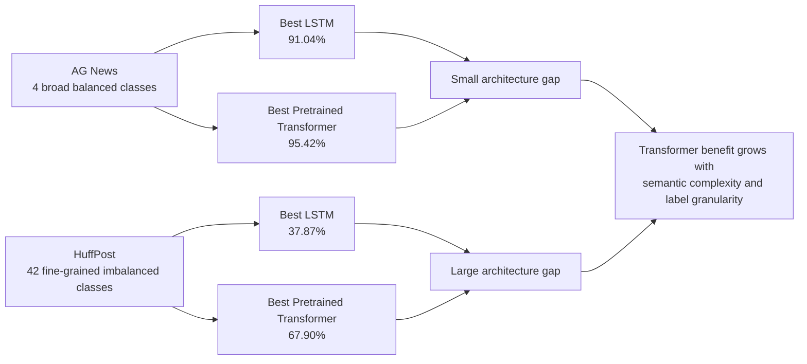
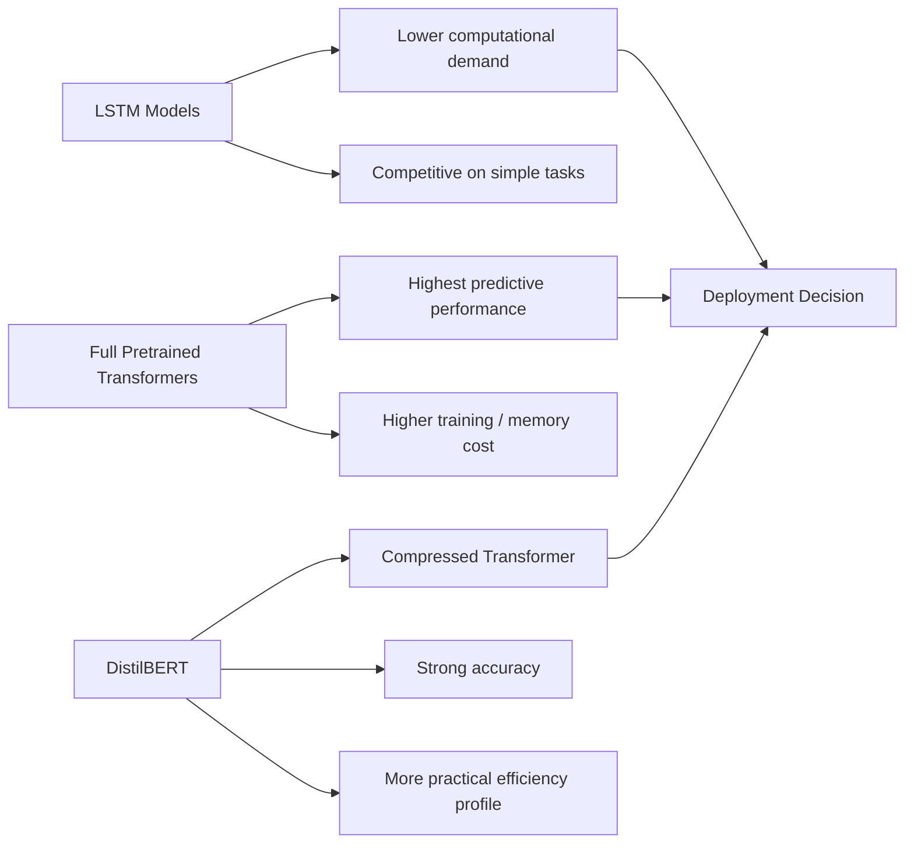

# Comparative Evaluation of Transformer-Based and LSTM-Based Models for News Topic Classification

### A research benchmark across AG News and HuffPost

**LSTM • Self-Attention LSTM • CNN-LSTM • BiLSTM • Scratch Transformer • BERT • DistilBERT • RoBERTa • ALBERT**

---

## Project Overview

News classification is a core NLP problem: given a headline or short news text, the model must assign it to the correct topic.

This project asks a more specific question:

> **How do recurrent neural networks and modern Transformer models behave when the classification problem changes from a small, balanced label space to a large, fine-grained and imbalanced one?**

To answer this, nine deep-learning models were evaluated on two complementary datasets:

- **AG News** — four broad, balanced topic classes.
- **HuffPost News Category** — 42 fine-grained categories with a strong long-tail distribution.

The project compares **predictive performance, model family, pretraining, task complexity, class imbalance and computational trade-offs**.

---

## Research Questions

1. Can LSTM-based models remain competitive with Transformers on a relatively simple news classification task?
2. What happens when the number of categories increases and labels become semantically similar?
3. How much does **language-model pretraining** help compared with a Transformer trained from scratch?
4. Which models provide the strongest accuracy, and where does computational efficiency become important?

---

## Experimental Pipeline

The same overall research logic is applied to both datasets so that the behavior of different architectures can be compared under different levels of classification difficulty.

---

## Datasets

### AG News

AG News represents a **coarse-grained and balanced** classification setting.

| Property | Description |
|---|---|
| Classes | **4** |
| Topics | World, Sports, Business, Sci/Tech |
| Standard training samples | **120,000** |
| Standard test samples | **7,600** |
| Difficulty | Relatively low |
| Main challenge | Distinguishing broad news themes |

The model input combines the available news text fields so that classification is based on meaningful textual context rather than a single isolated token or keyword.

### HuffPost News Category

HuffPost represents a substantially more difficult classification setting.

| Property | Description |
|---|---|
| Records | **209,527** |
| Categories used in the dataset | **42** |
| Text fields | Headline + short description |
| Class distribution | Strongly imbalanced |
| Difficulty | High |
| Main challenges | Fine-grained categories, semantic overlap, long-tail imbalance |

The dataset contains dominant categories such as **Politics**, **Wellness** and **Entertainment**, while several categories contain far fewer examples. This makes it useful for testing whether a model can separate closely related topics rather than only broad domains.

---

## Why These Two Datasets?

This contrast is central to the project. A model that performs well on four broad categories is not necessarily able to distinguish dozens of closely related topics.

---

## Models Evaluated

### LSTM Family

The recurrent-model benchmark contains four architectures:

- **Vanilla LSTM** — sequential recurrent baseline.
- **Self-Attention LSTM** — adds an attention mechanism to recurrent representations.
- **CNN-LSTM** — combines local feature extraction with sequential modeling.
- **Bidirectional LSTM** — processes context in both forward and backward directions.

### Transformer Family

Five Transformer configurations are compared:

- **Scratch Transformer** — Transformer architecture without pretrained language knowledge.
- **BERT-base-uncased**
- **DistilBERT-base-uncased**
- **RoBERTa-base**
- **ALBERT-base-v2**

The **Scratch Transformer** is particularly important because it helps separate the effect of the Transformer architecture from the effect of large-scale language-model pretraining.

---

## Conceptual Difference Between the Model Families

**LSTMs** propagate information through the sequence step by step.  
**Transformers** use self-attention to model relationships between tokens more directly.  
For BERT-family models, this architecture is combined with **pretrained linguistic knowledge** learned before fine-tuning on the news dataset.

---

## Experimental Setup

The experiments use:

- **Accuracy** as the main consolidated performance measure.
- **Macro F1-score** for class-balanced evaluation.
- **Training time** to examine computational efficiency.
- **Confusion matrices** and per-class results for error analysis.

Training was carried out using **Google Colab and Kaggle** with an **NVIDIA T4 GPU (16 GB VRAM)**.

Core tools used in the experiments include:

- Python
- PyTorch
- Hugging Face Transformers
- TensorFlow / Keras
- scikit-learn

The project also explores hyperparameters such as embedding dimension, hidden size, dropout, learning rate, batch size and maximum sequence length.

---

# Results

## Complete Test-Accuracy Comparison

| Model | Model Family | AG News | HuffPost |
|---|---|---:|---:|
| Vanilla LSTM | LSTM | **91.04%** | 34.09% |
| Self-Attention LSTM | LSTM | 90.99% | 35.06% |
| CNN-LSTM | LSTM | 90.86% | 33.93% |
| Bidirectional LSTM | LSTM | 90.88% | **37.87%** |
| Scratch Transformer | Transformer | 91.22% | 61.07% |
| BERT-base-uncased | Pretrained Transformer | 94.50% | **67.90%** |
| DistilBERT-base-uncased | Pretrained Transformer | 93.30% | 64.52% |
| RoBERTa-base | Pretrained Transformer | **95.42%** | 67.09% |
| ALBERT-base-v2 | Pretrained Transformer | 93.30% | 66.16% |

The table above reproduces the consolidated model accuracies reported in the project.

---

## AG News Results

  

### Interpretation

AG News is the easier benchmark. All LSTM models cluster near **91% accuracy**, showing that recurrent networks can already learn broad topic boundaries effectively.

The pretrained Transformers nevertheless improve the result:

- **RoBERTa-base:** 95.42%
- **BERT-base:** 94.50%
- **DistilBERT-base:** 93.30%
- **ALBERT-base-v2:** 93.30%

The strongest result is therefore obtained by **RoBERTa-base**.

The important point is not simply that Transformers perform better; it is that the gain is **relatively modest on a simple, balanced four-class problem**.

---

## HuffPost Results

  

### Interpretation

HuffPost changes the picture dramatically.

The best recurrent model, **Bidirectional LSTM**, reaches **37.87%**, whereas pretrained Transformers achieve approximately **64–68%**.

The strongest HuffPost results are:

- **BERT-base:** 67.90%
- **RoBERTa-base:** 67.09%
- **ALBERT-base-v2:** 66.16%
- **DistilBERT-base:** 64.52%

The Scratch Transformer reaches **61.07%**, already far above the LSTM family, but remains below the pretrained models.

This shows that the advantage of Transformer-based contextual modeling becomes much larger when the problem contains many classes, class imbalance and semantically overlapping labels.

---

## Architecture and Pretraining Effect

  

This figure summarizes one of the project's most important findings.

### On AG News

The difference between the best LSTM and a Transformer trained from scratch is small:

**91.04% → 91.22%**

The best pretrained Transformer then increases performance to:

**95.42%**

### On HuffPost

The progression is much more pronounced:

**37.87% → 61.07% → 67.90%**

from:

**Best LSTM → Scratch Transformer → Best pretrained Transformer**

This provides two useful observations:

1. **Transformer architecture itself contributes substantially on the difficult dataset.**
2. **Pretraining provides an additional improvement beyond architecture alone.**

---

## What Changes as the Task Becomes Harder?

The experiment therefore suggests that model choice becomes increasingly important as the classification problem becomes more fine-grained.

---

## Pretraining Matters

The project includes a **Scratch Transformer** specifically to test whether performance improvements are caused only by the Transformer architecture.

The answer from the experiments is no.

| Dataset | Scratch Transformer | Best Pretrained Transformer | Difference |
|---|---:|---:|---:|
| AG News | 91.22% | 95.42% | +4.20 percentage points |
| HuffPost | 61.07% | 67.90% | +6.83 percentage points |

Pretrained models begin fine-tuning with rich contextual language representations. That prior knowledge appears particularly useful when category distinctions depend on subtle semantics rather than obvious topic keywords.

---

## Error Analysis

Accuracy alone does not explain the complete behavior of the classifiers.

The confusion-matrix analysis in the project shows that errors are often concentrated among **semantically related classes**.

Examples discussed in the study include:

- **Politics ↔ World News**
- **Entertainment ↔ Arts-related categories**
- confusion of minority categories with more frequent majority categories

On the easier AG News benchmark, errors are more limited because the topic boundaries are broader.

On HuffPost, the class structure is much more difficult. Even BERT still shows uneven per-class behavior, meaning that pretrained Transformers **reduce but do not eliminate** the effect of class imbalance.

---

## Accuracy vs. Efficiency

The experiments reveal a practical trade-off:

Full pretrained Transformers produce the strongest accuracy, but require substantially greater computational resources than recurrent models.

**DistilBERT** is therefore important in the benchmark because it represents the performance–efficiency middle ground: Transformer-style pretrained representations with a lighter architecture.

---

## Main Findings

### 1. Pretrained Transformers are the strongest overall model family

They outperform the recurrent models on both datasets, with the largest advantage appearing on HuffPost.

### 2. LSTMs remain effective for coarse-grained classification

Approximately **91% accuracy on AG News** demonstrates that recurrent models are still capable when classes are broad, balanced and comparatively easy to separate.

### 3. Dataset complexity changes the importance of architecture

The gap between model families is relatively small on AG News and very large on HuffPost.

### 4. Transformer architecture alone is not the whole story

The Scratch Transformer outperforms LSTMs strongly on HuffPost, but pretrained BERT-family models improve further.

### 5. Pretraining is especially valuable for fine-grained semantics

Closely related categories require contextual understanding that cannot always be learned efficiently from a task-specific dataset alone.

### 6. Class imbalance remains an unresolved challenge

Pretrained Transformers improve minority-class behavior but do not completely solve long-tail classification.

### 7. Performance must be considered together with computational cost

The highest-accuracy model is not automatically the most practical model for every deployment environment.

---

## Limitations

The project also identifies several limitations:

- **Computational cost:** pretrained Transformers require more GPU memory and training time.
- **Class imbalance:** HuffPost minority classes remain substantially harder to predict.
- **Semantic overlap:** some topic categories are naturally difficult to separate.
- **Domain dependence:** performance on these datasets does not guarantee equivalent behavior on different news publishers or future distributions.
- **Domain drift:** language, topics and news events evolve over time.
- **Input scope:** experiments focus on headlines and descriptions rather than long-form full articles.
- **Model interpretability:** the benchmark explains performance differences primarily through quantitative and error-analysis evidence rather than full explainability methods.

---

## Future Work

Potential extensions include:

- class-weighted learning and advanced imbalance-aware objectives,
- data augmentation for minority categories,
- domain-adaptive pretraining on large news corpora,
- lightweight Transformers such as TinyBERT or MobileBERT,
- knowledge distillation,
- ensemble classification,
- hierarchical topic classification,
- cross-publisher generalization experiments,
- temporal robustness testing,
- attention and explainability analysis,
- deployment-oriented latency and memory benchmarking.

---

## Technology Stack

---

## Repository Scope

This repository is intended as a **research-project showcase**.

It presents the problem, experimental design, model families, quantitative results, interpretation, limitations and future directions in a form that can be understood without opening the original experimental notebooks.

**Source code, training notebooks and datasets are intentionally not included.**
