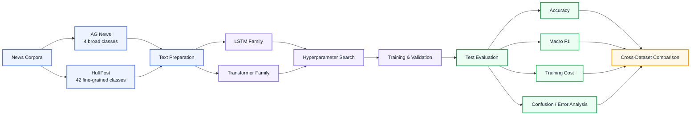
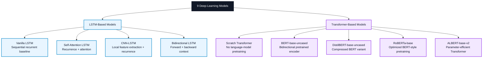
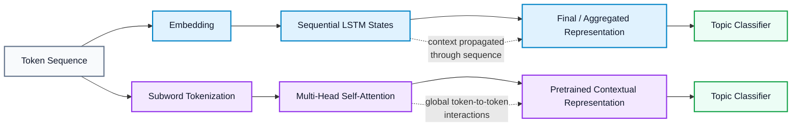
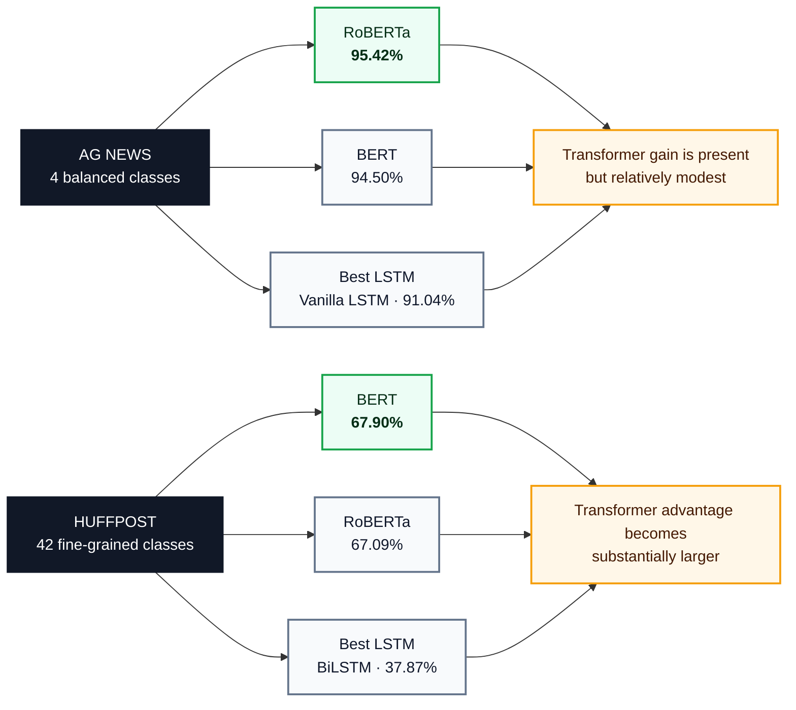
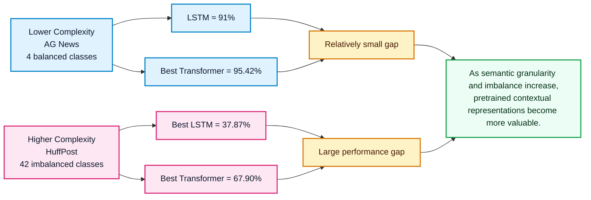

# Comparative Evaluation of Transformer-Based and LSTM-Based Models for News Topic Classification

**A systematic benchmark of recurrent and Transformer architectures across coarse-grained and fine-grained news classification**

---

## Overview

This project investigates how **LSTM-based neural networks** compare with **Transformer-based language models** for multi-class news topic classification. The study evaluates **nine deep-learning architectures** on two complementary benchmarks:

- **AG News** — a balanced, four-class news dataset representing a relatively coarse-grained classification problem.
- **HuffPost News Category** — a much larger, imbalanced, fine-grained dataset with **42 categories**, creating a substantially harder semantic classification problem.

The central objective is not only to compare classification accuracy, but also to study the effects of **pretraining, model architecture, dataset complexity, class imbalance, and computational cost**.

> **Main result:** pretrained Transformers consistently outperform LSTM-based models, and their advantage becomes much larger as the classification problem becomes more fine-grained and semantically ambiguous.

---

## Project at a Glance

| Dimension | Scope |
|---|---|
| **Task** | Multi-class news topic classification |
| **Datasets** | AG News and HuffPost News Category |
| **Model families** | LSTM-based networks and Transformer-based models |
| **Total models compared** | 9 |
| **Primary metrics** | Test accuracy, macro F1-score, training time |
| **Compute environment** | Kaggle / Google Colab with NVIDIA T4 GPU |
| **Core frameworks** | PyTorch, Hugging Face Transformers, TensorFlow / Keras |
| **Primary research question** | How does the accuracy–efficiency trade-off change as topic classification becomes more complex? |

---

## Study Design

<b>Figure 1.</b> End-to-end experimental workflow used to compare recurrent and Transformer architectures.

---

## Datasets

### AG News

AG News contains **four broad topic categories**:

**World · Sports · Business · Sci/Tech**

The standard dataset provides approximately **120,000 training samples** and **7,600 test samples**. The classes are balanced, making AG News a useful benchmark for evaluating model behavior when the label space is small and clearly separated.

For the experiments, the **title and description were combined** to form the textual input, with an internal validation split used during model development.

### HuffPost News Category

The HuffPost dataset contains **209,527 news records** distributed across **42 categories**. Input text was formed by combining the **headline** and **short description**.

Unlike AG News, HuffPost exhibits a strong **long-tail class distribution**. Large classes such as *Politics* contain substantially more examples than many minority topics, while several categories are semantically close to one another. This combination of **class imbalance + label overlap + greater class cardinality** makes HuffPost a much more demanding benchmark.

The principal HuffPost experiments used a stratified:

**70% training · 15% validation · 15% test split**

---

## Model Landscape

<b>Figure 2.</b> Model families included in the comparative benchmark.

---

## Architectural Perspective

The two model families solve the same classification problem in fundamentally different ways.

<b>Figure 3.</b> Conceptual comparison of recurrent sequence modeling and pretrained self-attention.

---

## Experimental Methodology

### Text preparation

The experiments combine the primary text fields available in each dataset:

- **AG News:** title + description
- **HuffPost:** headline + short description

The notebooks include text normalization, tokenization, vocabulary construction for recurrent models, and model-specific subword tokenization for pretrained Transformers.

### Hyperparameter exploration

The study explores compact but meaningful search spaces for both model families.

| Family | Main hyperparameters explored |
|---|---|
| **LSTM models** | Embedding dimension, hidden dimension, dropout, learning rate, batch size |
| **Transformers** | Model backbone, learning rate, batch size, maximum sequence length, training epochs |

For LSTM models, experiments considered embedding dimensions of **200–300**, hidden dimensions of **128–256**, dropout values of **0.3–0.5**, and learning rates around **1e-3 to 5e-4**.

For pretrained Transformers, fine-tuning explored learning rates around **2e-5 to 5e-5**, batch sizes of **16–32**, and maximum sequence lengths of **64–128 tokens**.

### Evaluation

Model comparison is based primarily on:

- **Test accuracy**
- **Macro-averaged F1-score**
- **Training time / computational demand**
- **Training and validation behavior**
- **Confusion matrices and category-level error patterns**

---

# Results

## Consolidated Test Accuracy

| Model | Family | AG News | HuffPost |
|---|---|---:|---:|
| Vanilla LSTM | LSTM | 91.04% | 34.09% |
| Self-Attention LSTM | LSTM | 90.99% | 35.06% |
| CNN-LSTM | LSTM | 90.86% | 33.93% |
| Bidirectional LSTM | LSTM | 90.88% | **37.87%** |
| Scratch Transformer | Transformer | 91.22% | 61.07% |
| BERT-base-uncased | Pretrained Transformer | 94.50% | **67.90%** |
| DistilBERT-base-uncased | Pretrained Transformer | 93.30% | 64.52% |
| RoBERTa-base | Pretrained Transformer | **95.42%** | 67.09% |
| ALBERT-base-v2 | Pretrained Transformer | 93.30% | 66.16% |

> Bold values identify the strongest result within the relevant comparison shown in each dataset column.

---

## Performance Snapshot

<b>Figure 4.</b> The Transformer advantage grows sharply as the classification task becomes more complex.

---

## What the Results Show

### 1. AG News is comparatively forgiving

All four LSTM variants achieve roughly **91% test accuracy** on the balanced four-class AG News dataset. This indicates that recurrent networks can learn the dominant topic structure effectively when classes are broad and well represented.

Pretrained Transformers improve the result further, with **RoBERTa-base reaching 95.42%** and **BERT-base reaching 94.50%**.

### 2. HuffPost exposes the limits of recurrent models

The performance gap becomes much larger on HuffPost. The strongest LSTM result is **37.87%**, while pretrained Transformers reach approximately **64–68%**.

This is consistent with the increased difficulty created by:

- 42 fine-grained labels
- strong class imbalance
- overlapping topic semantics
- varied linguistic expressions
- minority categories with fewer training examples

### 3. Pretraining matters

The **Scratch Transformer** reaches **61.07%** on HuffPost, substantially above the LSTM family but below the pretrained Transformer models.

This comparison isolates an important finding: the Transformer architecture itself is useful, but **large-scale language-model pretraining provides an additional performance advantage**.

### 4. The strongest model depends on the dataset

- **AG News:** RoBERTa-base — **95.42%**
- **HuffPost:** BERT-base — **67.90%**

The ordering changes slightly across datasets, showing that model behavior remains dataset-dependent even among closely related pretrained Transformers.

### 5. Efficiency remains an important trade-off

Pretrained Transformers deliver the strongest predictive performance but require substantially more computation than the LSTM baselines. The experiments identify **DistilBERT** as a useful middle ground when computational resources are constrained: it retains strong classification performance while targeting a lighter architecture than full BERT.

---

## Accuracy vs. Task Complexity

<b>Figure 5.</b> Relationship between task complexity and the observed benefit of pretrained Transformer models.

---

## Error Analysis

The project also examines confusion matrices and per-class classification behavior.

On **AG News**, errors are relatively limited and tend to occur between conceptually related broad categories, such as **Business** and **World**.

On **HuffPost**, confusion is much more pronounced because many labels have overlapping semantic boundaries. Examples include:

- *Politics* vs. *World News*
- *Entertainment* vs. *Arts / Culture*
- majority classes vs. underrepresented minority categories

BERT produces a substantially stronger diagonal structure in the HuffPost confusion analysis than the simpler models, indicating more consistent category separation. Nevertheless, minority classes still show weaker recall and F1-score, demonstrating that **pretrained Transformers reduce—but do not eliminate—the class-imbalance problem**.

---

## Key Findings

| Finding | Interpretation |
|---|---|
| **Pretrained Transformers outperform LSTMs** | Contextual pretraining provides a strong advantage for news classification. |
| **The performance gap grows with task complexity** | Fine-grained, semantically overlapping categories benefit more from Transformer representations. |
| **Pretraining is important** | The Scratch Transformer underperforms pretrained BERT-family models. |
| **LSTMs remain competitive on simple tasks** | Around 91% accuracy on AG News shows that recurrent models remain useful for coarse-grained classification. |
| **BERT and RoBERTa are consistently strong** | They produce the highest results across the two datasets. |
| **DistilBERT offers a practical efficiency option** | It provides strong Transformer performance with a lighter design. |
| **Class imbalance remains difficult** | Minority HuffPost categories continue to show weaker predictive performance. |

---

## Limitations

This study has several important limitations:

1. **Computational cost** — full pretrained Transformers require greater GPU memory and longer training time than LSTM-based models.
2. **Dataset dependence** — performance on AG News and HuffPost does not guarantee equivalent behavior on other publishers, domains, or future news distributions.
3. **Class imbalance** — the long-tail HuffPost distribution disproportionately affects minority categories.
4. **Semantic overlap** — some topic labels are intrinsically difficult to distinguish because their meanings partially overlap.
5. **Domain drift** — news vocabulary, events, writing styles, and category definitions change over time.
6. **Sequence coverage** — the experiments focus primarily on headlines and short descriptions rather than full-length news articles.

---

## Future Research

The project naturally extends toward several directions:

- **Data augmentation** for underrepresented news categories
- **Class-weighted or imbalance-aware training**
- **Lightweight Transformers** such as TinyBERT or MobileBERT
- **Knowledge distillation** for faster deployment
- **Ensemble systems** combining complementary model families
- **News-domain adaptive pretraining**
- **Model interpretability and attention-based error analysis**
- **Robustness testing across publishers and time periods**
- **Hierarchical classification** for semantically related topic groups

A particularly promising deployment strategy is a **two-stage classifier**, where a lightweight model handles straightforward examples and a larger pretrained Transformer is reserved for ambiguous cases.

---

## Technology Stack

---

## Repository Scope

This repository is intentionally presented as a **research-project summary** rather than a source-code distribution.

The README documents:

- the research motivation,
- dataset design,
- model families,
- experimental methodology,
- complete consolidated accuracy comparison,
- architectural interpretation,
- key findings,
- limitations,
- and future research directions.

**Implementation code and experiment notebooks are intentionally not included.**

---

## Contributors

This work was carried out by:

- **Adilkhan Alikhanov** — Nazarbayev University
- **Diar Demeubay** — Nazarbayev University
- **Nurbek Moldakhmetov** — Nazarbayev University
- **Tanveer Ahmed** — Nazarbayev University

---

## Selected References

1. Vaswani, A. et al. **Attention Is All You Need.** *NeurIPS*, 2017.
2. Devlin, J., Chang, M.-W., Lee, K., & Toutanova, K. **BERT: Pre-training of Deep Bidirectional Transformers for Language Understanding.** 2019.
3. Sanh, V., Debut, L., Chaumond, J., & Wolf, T. **DistilBERT, a distilled version of BERT: smaller, faster, cheaper and lighter.** 2020.
4. Liu, G. & Guo, J. **Bidirectional LSTM with attention mechanism and convolutional layer for text classification.** *Neurocomputing*, 2019.
5. **AG News Classification Dataset** — four-class news topic benchmark.
6. **HuffPost News Category Dataset** — large-scale fine-grained news categorization benchmark.

---

### Research takeaway

**When news categories are broad and balanced, LSTMs remain effective.  
When categories become numerous, imbalanced, and semantically overlapping, pretrained Transformers provide a much stronger advantage.**

